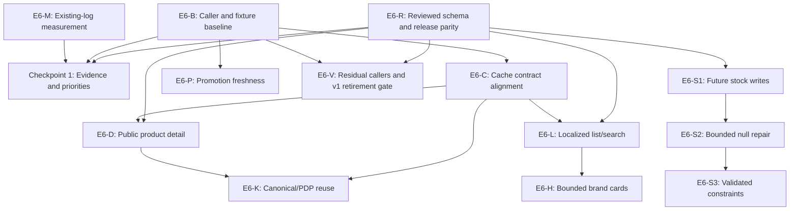

# Supabase Egress Follow-Up Implementation Plan

> **For agentic workers:** Use `executing-plans` to implement one task at a time. Read the linked investigation and current code before each task. This document is a plan for human review, not an instruction to execute migrations now.

**Goal:** Reduce verified, avoidable storefront catalog traffic while preserving product identity, Bengali output, sellable stock, tenant isolation, and reliable schema/application releases.

**Architecture:** Reuse the existing repository, public anonymous client, cache boundaries, and test environment. Introduce small additive public read contracts only where complete-path measurements justify them. Keep stock tenant repair on a separate integrity track and release each reviewed migration with its matching application changes.

**Tech Stack:** Next.js 16.4.5 / React 19, TypeScript, Supabase Postgres/PostgREST, Vitest, Playwright, existing GitHub Actions and Hostinger release tooling.

**Spec:** [Phase 5 investigation](../system-docs/audits/lucky-store-phase-5-supabase-egress.md), the current request, [repository guidelines](../AGENTS.md), and [deployment guide](../DEPLOYMENT.md). The investigation's historical PR proposals are not a current shipped-work checklist. No separate `SPEC.md` was found.

**Status:** Planning only, based on local `main` at `d6c50dc5`, 8 November 2026. No live log queries, migrations, application changes, or deployments were performed to create this plan. Execution checklist: [todo.md](todo.md).

## Global Constraints

- Test project: `grxxenvdhfwzafzyykgo`. Production: `hvmyxyccfnkrbxqbhlnm`. Verify the actual target before every remote operation.
- User release rule for this workstream: after final PR review, apply the matching, test-validated production migrations without another conversational approval request. Final review must cover the exact SQL, migration versions, target, security behavior, and any bounded data repair.
- Migration parity means the reviewed production-intended schema/contracts and migration history match the release, not that production data equals test fixtures. Never copy test-only migrations, replay unknown historical SQL, or silently repair migration history.
- Planning does not change provider protection settings or grant permission to bypass configured safeguards. Missing credentials, unknown drift, or failed checks stop release execution.
- Use the Hostinger workflow for storefront releases. Preserve one immutable application artifact across Hostinger staging and production; never manually upload `app.zip`.
- Keep mutation-capable E2E, fixture creation, old/new benchmarks, and load tests on the test project. Do not load-test production-backed Hostinger staging accidentally.
- Preserve RLS, grants, tenant/store checks, audit logging, idempotency, purchase/ledger controls, and authoritative checkout repricing/reservations. Browse caches never authorize checkout.
- No new production request-counting infrastructure. Existing Supabase gateway logs are sufficient for endpoint counts; caller attribution and test-fixture byte measurements are separate.
- Preserve the current public-store visibility predicate, including `COALESCE(is_public_storefront, true)`, unless a separately identified security/product change is reviewed.
- Do not extend existing browse TTLs as an incidental optimization. Keep public anonymous caches separate from custom/authenticated clients.
- Benchmark budget per test-backed run: one concurrent scenario, at most 20 scenarios, 500 upstream requests, or 10 MB serialized responses, whichever comes first. Count failures, redirects, retries, and fallbacks.
- Record only allowlisted aggregate/fixture metadata. Never record tokens, auth headers, raw search queries, customer identifiers, IPs, addresses, production response bodies, or connection strings.
- Each task carries its own regression tests, focused validation, final review, and release/postcheck when applicable. A green workflow label is not proof that its named checks actually ran.

## Review Focus

- A prefix collision, hidden item, wrong store, or unknown stock must not become a purchasable product through a snapshot, cached miss, or detail fallback. Owned by E6-D and E6-K.
- Missing translations and failed translation reads are different states; failed reads must not set `bengaliTranslationResolved` or poison a healthy public cache. Owned by E6-C, E6-D, and E6-L.
- Category-array ordering, bilingual matches before pagination, and brand-family aliases must not change silently when moving filters into SQL. Owned by E6-L and E6-H.
- A late response after invalidation, cart replacement, or tab restore must not overwrite newer product/pricing state. Owned by E6-C and E6-P.
- A migrated stock row must retain its quantities/reservations and audit history; a changed PR SHA or incomplete schema must stop application promotion. Owned by E6-R and E6-S1 through E6-S3.

## Shipped Baseline

- PR #598 / `ca1431ec`: bounded prefix resolver, strict prefix/UUID handling, normalized prefix caching, and prefix invalidation. Do not rebuild the old full-catalog scanner.
- PR #599 / `0d9845a4`: concurrent-read coalescing, generation-based invalidation protection, and the adapter's 60-second category cache. These are already implemented.
- PR #600 / `02593530`: verified-no-translation marker and reuse, plus concurrent fallback overlay batches. Further payload work must preserve those semantics.
- PR #601 / `2283fc69`: anonymous PDP stock reads use the exact catalog stock projection without the guaranteed-empty `stock_levels` preflight. Authenticated/direct reads remain unchanged.
- The existing cart already skips promotion requests for empty carts, pauses its interval while hidden, refreshes on restore, and deduplicates requests within an effect. Remaining work concerns unnecessary effect restarts and time-boundary freshness, not reimplementing those protections.
- The supplied 22-minute observations were `stock_levels` 18 to 0, `items` 38 to 27, catalog v2 29 to 53, translations 36 to 61. They support a targeted request reduction, not overall billable-egress savings.

## Current Paths

- `SupabaseProductAdapter.ts`: anonymous detail still reads `items`, cached taxonomy, and exact-ID catalog stock; semantic slugs also need the bounded selector. A unified public detail operation can remove overlap.
- `searchProducts.ts`: v2-only search, Bengali pre-match query, per-category fanout, and 100-ID translation overlays. No unconditional v1-then-v2 sequence was found there.
- `CachingProductAdapter.ts`: prefix invalidation and race handling exist. Search keys still use raw criteria; write-to-cache invalidation reachability and nested-cache freshness need proof.
- `getCachedCategories.ts`: 300-second Next cache wraps repository/category caches. A nominal outer TTL does not prove fresh inner data.
- EN/BN brand pages: `searchAllPages` fetches up to ten 500-row pages per configured term, then filters parsed brand identities locally. Markdown brand output is another consumer.
- `brandsData.ts:isProductOfBrand` compares normalized parsed brand names/aliases; `RuleBasedBrandParser` supplies family/name fallback. SQL `brand ILIKE` alone is not equivalent.
- `sitemap.ts:159` is a surviving first-party v1 runtime call. Exact-symbol search is not a full census of other apps, scheduled jobs, or external clients.
- `middleware.ts:17-82` performs a separate, bounded, no-store identity lookup. React request caching does not share that result with middleware or a followed browser redirect.
- Current release checks lack a mandatory migration dependency. The Hostinger staging job invokes smoke checks, not demonstrated E2E/load execution; expected-SHA checking and packaging order also need explicit assertions. E6-R owns this gap.
- Historical stock evidence found 670 null `tenant_id` rows, with matching item/store tenants and no orphans. Do not use that old count as a current repair authorization or evidence of leakage.

## Dependency Graph

E6-M and E6-B can proceed independently of E6-R. Missing log access blocks measurements and billing conclusions, not read-only caller analysis or test-project correctness work. Implement shared storefront adapter changes sequentially even when the conceptual graph permits parallel work. Stock repair is not a prerequisite for catalog egress savings.

## Task E6-M: Complete Longer-Window Production Measurement

**Deliverable:** A reproducible, read-only amendment to the existing audit with explicit evidence limits. No application change or migration.

**Files:** Update `system-docs/audits/lucky-store-phase-5-supabase-egress.md`; do not publish raw logs. The audit is currently Git-ignored, so a PR needing its evidence must carry an approved sanitized summary.

**Interface:** Aggregate records contain project, UTC start/end, release SHA/cohort, endpoint, method, request count, known status/error counts, unknown-status count, valid-length coverage, summed known lengths, traffic denominator/source, and provider usage period/source.

- [ ] Verify read-only access through exposed MCP `query_logs`, authorized Management API access, or Explorer. If unavailable, document the blocker precisely; do not change MCP/credential configuration or invent zero counts.
- [ ] Use the current `/analytics/endpoints/logs` API and ClickHouse SQL, not retired `logs.all` or Postgres `execute_sql`. Confirm recorded fields; current docs use `logs`, `source = 'edge_logs'`, `log_attributes`, and `count()`.
- [ ] Compare candidate one-hour windows `[2026-11-08T02:15:00Z,03:15:00Z)` and `[2026-11-08T03:30:00Z,04:30:00Z)`, after verifying actual release boundaries and log retention.
- [ ] Compare candidate 24-hour windows `[2026-11-07T03:15:00Z,2026-11-08T03:15:00Z)` and `[2026-11-08T03:30:00Z,2026-11-09T03:30:00Z)`. The latter cannot be complete before 9 November at 03:30 UTC. Record the 15-minute clock shift and all intervening releases; select better retained windows if needed.
- [ ] Keep endpoint/method filters identical, include total REST traffic and all relevant RPCs, and separate missing/non-numeric lengths/statuses from measured zeros. Align existing storefront traffic and provider-reported regular billable egress to comparable periods where available.
- [ ] Check HTTP status and query errors, source/filter coverage, complete windows, and the arithmetic before accepting results. Label mixed-release, low-traffic, missing-denominator, or missing-billing comparisons as inconclusive.

**Acceptance:** One-hour comparison complete; 24-hour comparison completed or explicitly time/access-blocked; no claim of zero stock requests indefinitely or monthly savings from request/JSON-size counts alone. A future wait uses scheduled continuation, not repeated polling.

## Task E6-R: Make Reviewed Migrations and Releases Match

**Deliverable:** One end-to-end release gate linking reviewed SQL, test validation, production schema, and the immutable app artifact.

**Files:** `.github/workflows/storefront.yml`, `.github/workflows/storefront-hostinger.yml`, `scripts/ci/smoke-test.mjs`, `scripts/deploy/package-standalone.mjs`; add `scripts/ci/release-migrations.mjs` and `scripts/ci/release-migrations.test.mjs` if no existing runner can provide the contract safely.

**Interface:** A release manifest binds the final reviewed commit to production-intended migration version/name/SHA-256 entries and required RPC contracts. Attestations bind target project, applied versions/hashes, owner/search-path/grants checks, actual test results, and artifact SHA to that same commit.

- [ ] Add failing tests for wrong target, changed SQL/hash/SHA, unknown remote-only history, unreviewed pending migrations, missing RPC/incorrect grants, failed test validation, and a smoke response serving the wrong build SHA.
- [ ] Read both migration histories and verify the already-shipped prefix selector's existence, definition, owner, empty search path, role grants, and bounded request behavior. Never infer production migration success solely from an application deploy or fallback-rendered PDP.
- [ ] Use an exact-reviewed runner with check-only and apply modes. Pin a tested CLI version and inspect `--version`/`--help`; current CLI v3 changes remote targeting and unattended confirmation. Do not upgrade or guess flags incidentally.
- [ ] Do not reuse `scripts/db/run_migrations.sh` (hardcoded production/historical glob) or `scripts/db/migrate.sh` (untargeted push/reset). A receipt-function workflow's CLI pin is not an existing database release gate.
- [ ] Test the exact pending manifest on the test project; exercise RPCs with actual anon/customer/staff/wrong-tenant roles. Seed fixtures only after the required schema is installed. Recheck the reviewed commit and manifest before production application.
- [ ] After final PR review, apply only the expected production-intended pending manifest to verified production, verify migration history and exposed RPC contracts, then allow matching app promotion. Serialize releases and fail closed on drift; no additional conversational approval prompt.
- [ ] Put build provenance into the standalone package before ZIP creation. Make smoke checks assert the expected SHA, not merely print it. Keep test-backed E2E/load evidence distinct from production-backed read-only Hostinger smoke checks.
- [ ] Test failed migration, failed smoke/provenance, and changed-commit cases: no production app promotion. Verify the same application artifact/hash goes from Hostinger staging to production.

**Verification:** `node --test scripts/ci/release-migrations.test.mjs`, applicable smoke/packaging regression tests, workflow validation, and test-project installed-RPC checks. Job names are not substitutes for the executed commands/artifacts.

**Acceptance:** Every database-bearing release proves reviewed/test/production parity before new app code depends on it. Missing credentials or unexplained existing drift remain operational blockers, not permission to bypass checks. Database-only stock releases use the same review/manifest/postcheck gate without inventing an app deployment.

## Task E6-B: Establish a Complete-Path Caller and Fixture Baseline

**Deliverable:** A classified caller inventory and bounded EN/BN benchmark for the already-shipped implementation.

**Files:** Existing adapter/search/overlay/repository tests, `apps/customer_storefront/e2e/support/mutationSafety.ts`, `scripts/ci/preflight_test_env.js`; add `apps/customer_storefront/e2e/egress-baseline.spec.ts` and a small `e2e/support/egressObserver.ts` only if existing fixtures cannot collect the evidence.

**Interface:** Allowlisted fixture observations include short-lived scenario ID, route/source or `unknown`, upstream operation, RPC/projection version, client scope, instance/cache state, status, rows, latency, and UTF-8 serialized response bytes. Browser-visible requests and server Supabase reads are reported separately.

- [ ] Classify actual v1/v2 calls across storefront, admin/mobile, scripts, scheduled workflows, and tests. Mark definitions/docs/historical migrations separately and external clients unknown until observed.
- [ ] Pin fixtures for EN/BN home/category/search, brand aliases, canonical/alias PDP, mobile detail/catalog, markdown/sitemap, empty/nonempty carts, collisions, inactive/wrong-tenant items, reservations, and missing/failed translations.
- [ ] Add observer redaction, disabled-by-default behavior, aggregate-byte, retry, and budget-stop tests. Instrument the existing client fetch boundary in the test harness so SSR/metadata/page reads are counted; browser network events alone cannot do that.
- [ ] Run cold/warm/cache-disabled cases and concurrent-identical requests in separate bounded scenarios; deliberately model two instances. Count retained taxonomy, middleware, related items, translations, and fallback operations as well as the primary read.

**Verification:** Focused Vitest observer/adapter tests and `npx playwright test e2e/egress-baseline.spec.ts --project=chromium --workers=1` from `apps/customer_storefront`, against a preflight-verified test-backed build. Mocked fixtures prove deterministic costs; live test-backed measurements are labeled separately.

**Acceptance:** Every benchmark operation has an observed source or an explicit unknown label; complete-path calls/rows/JSON bytes are recorded without billing claims. No staging instrumentation is required merely to execute E6-M's production gateway queries.

**Checkpoint 1:** Review E6-M access/evidence, E6-R release readiness, and E6-B caller/DTO snapshots. Proceed with measured candidates only; retain unresolved caller/traffic limitations. This review is not another production migration approval request.

## Task E6-C: Align Public Cache Keys and Invalidation

**Deliverable:** Semantically equivalent requests share the intended cache, without stale inner caches or authorization leakage.

**Files:** `app/lib/search/searchProducts.ts`, `app/lib/products/adapters/CachingProductAdapter.ts`, `app/lib/products/getCachedCategories.ts`, `app/lib/products/repository.ts` and their existing tests, relative to `apps/customer_storefront`.

**Interface:** Existing `SearchOptions`/`ProductSearchCriteria` and `CacheControl.invalidate` remain the seams. Normalize query/pagination equivalently across layers; include RPC/projection version and environment/store/client scope. Preserve category order when it affects current results.

- [ ] Add failing tests for equivalent query/pagination keys, ordered/duplicate category arrays, custom vs anonymous clients, price/activation/translation edits, nested taxonomy expiry, and late invalidated responses.
- [ ] Reuse shipped prefix normalization/invalidation and generation counters. Fix only demonstrated key/inner-freshness gaps; version keys for new DTOs rather than adding another generic cache.
- [ ] Trace real write-to-invalidation reachability. If no reliable cross-runtime invalidation transport exists, document TTL-bounded freshness and make that transport a separate reviewed design checkpoint; do not claim instant fleet-wide invalidation from a local Map or invent an unprotected webhook.
- [ ] Preserve degraded-error non-caching, existing TTL/cap values, client isolation, and `enableCache: false` fresh-read behavior. Compare warm/cold upstream reads with E6-B.

**Verification:** Existing `CachingProductAdapter.test.ts`, `searchProductsCache.test.ts`, `repository.test.ts`, and new focused taxonomy freshness tests.

**Acceptance:** Proven semantic key alignment, no new stale/null/error cache poisoning, and truthful invalidation/freshness guarantees. Each later DTO migration includes its corresponding key/tag/invalidation tests.

## Task E6-D: Serve Public Product Detail in One Bounded Operation

**Deliverable:** Anonymous exact-ID/prefix detail plus published Bengali detail in one public read contract, consumed by PDP metadata/page, mobile detail, and markdown.

**Files:** Add an additive migration using `supabase migration new storefront_public_product_detail`; update `SupabaseProductAdapter.ts`, `getCachedProduct.ts`, `products/types.ts`, Bengali PDP wrapper, `mobile/product.ts`, and focused adapter/SEO/mobile/markdown tests. Add a role-executed SQL contract test under `supabase/tests`.

**Interface:** Proposed `resolve_storefront_product_v1(p_store_id uuid, p_identifier text)` returns a validated result with `found`, `not_found`, or `ambiguous` status. Only a unique authorized-visible item carries the approved detail DTO: English canonical identity, public price/MRP, sellable stock, category identity, image, necessary descriptions/timestamps/brand/SKU, and published Bengali name/description/origin. Compatibility aliases are derived locally.

- [ ] Pin existing consumer fields and failing tests for malformed inputs, zero/one/two candidates, cross-tenant collisions, no stock, reservations, empty/missing/unpublished translations, RPC failure, and browse-only snapshots.
- [ ] Reuse #598's indexed UUID range/public-store/tenant/active predicate, but resolve and project the unique detail inside this operation. Do not call selector then detail as two upstream RPCs while claiming one.
- [ ] Preserve reviewed privilege/search-path/grant boundaries and deterministic translation precedence. Keep the authenticated/direct adapter path unchanged; no private reservation/cost fields enter the public DTO.
- [ ] Migrate only the anonymous path; keep React metadata/page coalescing and skip already-resolved downstream Bengali overlays, including verified absence. Keep unrelated taxonomy/enrichment/gallery/cross-sell work separate and counted.
- [ ] Run actual-role parity and complete-path fixture comparisons through E6-R/E6-B before release. Leave legacy RPCs installed for non-migrated callers.

**Acceptance:** One primary public product operation on the healthy migrated detail path; no separate item/stock/translation chain for that product. Middleware identity lookup is still counted until E6-K. No purchasable ambiguity, widened access, or loss of canonical/locale detail.

## Task E6-L: Consolidate Localized List/Search and Compact Payloads

**Deliverable:** One bounded card/search operation replaces translation matching/overlay and per-category upstream fanout on migrated search/category paths.

**Files:** Add a migration using `supabase migration new storefront_cards_search`; modify `app/lib/search/searchProducts.ts`, related search/cache/overlay tests, and only the search/category consumers that use its contract.

**Interface:** Proposed `search_storefront_cards_v1` accepts verified store, normalized query, ordered category IDs, limit, and offset. It returns compact card rows plus `hasMore`, with canonical English identity, required public fields and verified published Bengali overlay state. Detailed PDP/admin fields are not part of the card contract unless a traced card consumer actually needs them.

- [ ] Add parity tests for EN/BN/mixed search, literal punctuation/wildcards, category overlap/order, sort ties, offsets, empty pages, and translation matches beyond 1,000.
- [ ] Match authorized English/Bengali/search-term results and category filters before pagination; deduplicate in SQL. Retain current category ordering where contractual. Any cap/global-order correctness change is explicitly reviewed, not hidden as a behavior-preserving refactor.
- [ ] Remove unneeded upstream fields only after consumer snapshots prove absence. Recreate local compatibility aliases without transmitting duplicate spellings.
- [ ] Preserve shared anonymous cache eligibility and degraded-response behavior; migrate search/category first. Homepage consumers reuse that contract naturally; separate home-section deduplication is attempted only if E6-B proves duplicate DTO transfer and section/deal order remains unchanged.
- [ ] Compare full-path calls/rows/JSON bytes and actual-role output against identical E6-B fixtures; include taxonomy and fallback costs.

**Acceptance:** One primary operation for the migrated list query; no per-category remote fanout or second translation overlay on healthy rows; stable identity/results/`hasMore` and smaller measured fixture payloads. No extrapolated monthly saving.

## Task E6-H: Bound Brand Selection Without Losing Aliases

**Deliverable:** EN/BN and markdown brand listings retrieve the appropriate bounded brand card pages rather than broad searches per term followed by local filtering.

**Files:** `app/lib/brandsData.ts`, `products/parsers/BrandParser.ts`, EN/BN `brand/[slug]/page.tsx`, `app/api/markdown/route.ts`, and brand/parser/routing tests. Add a separate additive brand-filter migration rather than silently altering existing RPC semantics.

**Interface:** A versioned server-side brand policy reproduces parsed database-brand/name fallback followed by exact normalized family/alias membership. The application returns card pages/`hasMore` keyed by that policy version; preserve the visible BrandShell filtering/sort contract or review a pagination UX change separately.

- [ ] Pin aliases, accented names, parsed-family precedence, missing brands, overlapping search terms, and assortments beyond 500/5,000 rows against the current full-fixture oracle.
- [ ] Review how the existing policy maps to bounded SQL before implementing it. No plain `brand ILIKE`, guess-based product reassignment, or new canonical-brand data backfill.
- [ ] Filter before pagination and keep page/count/order behavior explicit. Migrate both locales and markdown together; remove `searchAllPages` only from migrated callers.
- [ ] Compare expected IDs and full-path bytes/calls. If semantic parity requires a new data model or UI contract, stop this task at that design checkpoint rather than ship silent assortment loss.

**Verification:** `brandsData.test.ts`, `BrandParser.test.ts`, added brand RPC/route fixtures, and EN/BN/markdown test-backed navigation.

**Acceptance:** Exact reviewed assortment and aliases, bounded selection, no silent ten-page truncation, and measured reduced broad transfer.

**Checkpoint 2:** Review each migrated D/L/H path separately: actual-role parity, cold/warm totals, degraded behavior, and unchanged UI/canonical contracts. Final PR review includes its exact migration manifest; apply/release through E6-R.

## Task E6-P: Reduce Promotion Refetches While Keeping Prices Fresh

**Deliverable:** Quantity/base-price-only cart changes do not restart the same promotion lookup unnecessarily, while membership/time/visibility changes stay correct.

**Files:** `app/hooks/useCart.ts`, `app/lib/storefront-promotions.ts`, `app/lib/__tests__/useCart.test.ts`, `storefront-promotions.test.ts`, and checkout promotion integration tests.

**Interface:** Promotion lookup identity is the deduplicated item-ID set for the existing store. Pricing inputs and current time remain separate from that identity. Keep the current maximum 30-second visible polling cadence for detecting changed campaigns.

- [ ] Add fake-clock tests for quantity-only changes, repricing with unchanged IDs, membership replacement during a pending request, hidden mount/restoration, promotion start/end, failure, and cleanup.
- [ ] Preserve empty-cart suppression, hidden interval pause, and existing request dedupe. Avoid effect restarts for unchanged membership; prevent responses for obsolete membership from committing.
- [ ] Refresh on membership/visibility changes and update displayed pricing at known start/end boundaries without an unnecessary Supabase call for a time-only recalculation. Do not extend campaign freshness or introduce realtime subscriptions to save polling.
- [ ] Verify checkout still revalidates price, stock, and eligibility; use E6-B to attribute browser promotion costs separately from node-shaped server traffic.

**Acceptance:** Fewer fixture promotion calls for quantity-only updates, no stale discount at time boundaries, no hidden steady-state polling, and unchanged authoritative checkout.

## Task E6-K: Prove, Then Implement Canonical/PDP Result Reuse

**Deliverable:** A shared primary public-product result serves pre-render canonical checks and page detail only if the deployed runtime can support it safely.

**Files:** `apps/customer_storefront/middleware.ts`, `getCachedProduct.ts`, SEO routing tests, and an isolated test-backed runtime fixture. Add a server-only resolver transport module/route only after the proof selects a supported existing boundary.

**Interface:** Reuse E6-D's approved public result. Any opaque internal hint is bound to normalized route/identity, public store, projection/language mode, and expiry; it is not authorization or a client-provided DTO.

- [ ] First verify the actual legacy middleware runtime and hosting adapter. Test two workers and alias-to-canonical HTTP hops; imported helpers/module Maps/React cache are not assumed shared. Installed Next 16 docs explicitly warn against shared Proxy/render globals.
- [ ] Choose a proven existing reusable application boundary. If none exists, record the gap and leave single-read reuse blocked pending a separate architecture decision; no default Redis/KV/service project.
- [ ] Add forged/expired/oversized hint, failure, eviction, rename/invalidation, GET/HEAD, RSC/prefetch, JS-disabled, slow/streaming, EN/BN, wrong-store, and collision tests before changing routing.
- [ ] Preserve early HTTP 308/404 and existing fail-open/fail-closed route distinctions. A late streaming meta redirect is not a replacement for an HTTP status. Pass only validated small internal request metadata, never the full DTO in headers/cookies/URL.
- [ ] Count the primary operation across canonical and followed-redirect requests, including worker/cache-miss exceptions and transport overhead. Count related/auth/taxonomy operations separately.

**Acceptance:** Healthy canonical request uses one primary product operation with correct early statuses. Alias-chain reuse is a measured healthy-cache target, not distributed exactly-once. An ID-only handoff or disappearance of `/items` requests alone does not complete this task.

**Checkpoint 3:** Review the runtime proof and transport/security/status evidence before implementing reuse. If blocked, E6-D remains a useful independently released improvement; no additional cache infrastructure is implied.

## Task E6-V: Migrate Residual Callers and Gate Legacy Retirement

**Deliverable:** Each confirmed remaining caller uses an appropriate contract; legacy RPC deprecation follows actual usage evidence rather than symbol counts.

**Files:** `app/sitemap.ts`, `app/__tests__/sitemap.test.ts`, verified `deals.ts`/`buying-guides/catalogue.ts`/selected-ID consumers, and only the scheduled scripts/preflight/tests classified in E6-B.

- [ ] Move sitemap's confirmed v1 caller to a bounded, minimal sitemap contract preserving positive-price/active eligibility, canonical English name, timestamps, brand/category identity, published BN eligibility, and sitemap URL/page limits.
- [ ] Retain exact-ID/category/name/price semantics for guides and deals; choose a compact selected-ID contract where evidence justifies it. Empty IDs mean empty, never browse-all. Do not replace these consumers with an oversized detail RPC.
- [ ] Verify EN/BN sitemap/markdown/guide/deal fixtures and record new call/payload totals. Do not migrate the already-paginated mobile catalog or authenticated admin model without a separate demonstrated need.
- [ ] Observe attributable v1 usage/errors over a complete known scheduled-job and external-client rollout cycle. If callers are unknown or only short-window zeros are available, leave the function installed.
- [ ] Deprecate in documentation first. Any revoke/drop is a separate final-reviewed migration with dependency checks and rollback impact; retain v2 until its own callers/internal dependencies are gone.

**Acceptance:** No residual first-party v1 call left in the verified census, preserved consumer contracts, and explicit runtime/external compatibility gate. No silent forwarding shim, historical migration rewrite, or premature grant revocation.

## Task E6-S1: Stop Future Null/Inconsistent Stock Tenant Writes

**Deliverable:** The stock write boundary derives tenant from validated item/store agreement and rejects conflicting supplied tenants, without changing quantities or existing authorization.

**Files:** Add a migration using `supabase migration new stock_tenant_write_guard`; role-executed stock tests; current import/purchase/adjustment integration fixtures and `scripts/ci/seed_test_storefront.js` where needed. Preserve the latest purchase cost/null guards and existing audit trigger.

**Interface:** An internal `BEFORE INSERT/UPDATE` guard, or reviewed current writer equivalent, fills only a missing stock tenant when item and store share the same non-null tenant. Non-null conflicts, missing references, or inconsistent item/store tenants fail. No client tenant claim supplies authority.

**Writer evidence:** Current catalog import stock insertion is in `20261029024810_fix_catalog_import_null_stock_mode.sql`; purchase posting inherits the stock insertion from `20261003160749_reconcile_purchase_rpc_ledger_precision.sql` plus the later `20261003180000_reject_unscoped_purchase_inventory_cost.sql` guard. Adjustment overloads are defined in `20260327200000_stock_adjustments.sql` and `20260423232000_production_hardening.sql`. Check installed definitions rather than replacing these historical files.

- [ ] Inventory currently installed writer overloads/grants, including catalog import, purchase posting, stock adjustment/helpers, service jobs, and direct fixture insertion. Historical source definitions/JWT claims alone do not prove current execution roles.
- [ ] Add tests with actual roles for legitimate insert/upsert/quantity-only update, wrong-tenant/store/item, forged tenant, existing null rows, and concurrency. Assert unchanged qty/reserved/online-reserved fields and audit behavior.
- [ ] Implement the single trusted invariant boundary without widening RLS/grants or restoring obsolete purchase/ledger implementations. Exercise each verified writer end-to-end against the exact installed test migrations.
- [ ] Release through E6-R and verify new legitimate writes no longer create nulls. Do not backfill historical rows in this task.

**Acceptance:** Every verified future writer preserves the tenant invariant, unauthorized/inconsistent writes fail, and inventory/financial semantics remain unchanged. Unclassified writers block constraint enforcement, not speculative production repair.

**Verification:** Add `supabase/tests/stock_tenant_integrity_test.sql` with actual-role checks, following the role-switch precedent in `p1_expenses_items_stock_isolation_test.sql`. Run `node --test scripts/ci/seed_test_storefront.test.js`, applicable import repository/request tests, and the guarded backend integration suite. New SQL proofs must be executed explicitly against installed test definitions; no historical RPC injection.

## Task E6-S2: Repair Existing Nulls in Reviewed Batches

**Deliverable:** A bounded, journaled, null-only tenant repair after E6-S1, not an inventory adjustment.

**Files:** Separate reviewed migration/runbook and role/integrity tests. Journal affected keys/old values privately outside public reports; do not embed production identifiers in tracked SQL.

- [ ] Recount nulls, orphans, item/store disagreement, and non-null conflicts in the verified target. Do not assume the historical 670-row count is current; retain a quantity/reservation baseline.
- [ ] Test the reviewed batch contract: at most 100 rows per transaction, null-only writes, deterministic key selection, lock contention/retry limits, unchanged quantities/reservations, and audit-trigger side effects. Set lock/statement budgets from staging evidence before final review.
- [ ] Review the exact total row/batch budget and journal plan with this PR. After final review, execute only that manifest/budget on production under the release rule; stop on any changed scope, unexpected count, conflict, error, or budget exhaustion. No unbounded backfill loop.
- [ ] Never overwrite non-null tenants, repair ambiguous relationships, disable audit triggers, or modify quantities. Re-run aggregate/invariant checks after each batch and at completion.

**Acceptance:** Only uniquely inferred null tenants changed; all quantities/reservations and existing non-null values preserved; journal and audit evidence present. Partial/budget-limited repair is reported as partial, not ready for NOT NULL.

## Task E6-S3: Enforce Validated Stock Tenant Constraints

**Deliverable:** Database enforcement only after future writers and existing rows have proven compatibility.

**Files:** A separate additive constraint migration and installed-schema/writer regression tests.

- [ ] Verify zero remaining nulls/conflicts/orphans, E6-S1 writer coverage, and complete E6-S2 postchecks under fresh production evidence.
- [ ] Test add/validate of the non-null CHECK followed by `SET NOT NULL` under reviewed lock budgets. Remember an unvalidated CHECK already constrains new writes; do not introduce it earlier.
- [ ] Preserve item/store tenant consistency through the verified guard. Composite tenant/item/store FKs require separately justified reference keys/indexes and delete/cascade tests; a tenant FK alone does not prove relationship agreement.
- [ ] Keep stock RLS tenancy predicates unchanged in this task. Run actual-role insert/update/denial tests and purchase/adjustment regressions, then release and verify via E6-R.

**Acceptance:** Validated non-null enforcement, no legitimate writer failures or lock-budget breach, preserved tenant/quantity/audit guarantees. Constraint or data rollback must be separately reviewed, journal-aware, and must not blanket-reset tenants or reverse inventory quantities.

**Checkpoint 4:** Independently review writer coverage, bounded repair evidence, and enforcement readiness. Stock repair is an integrity improvement; no egress-saving claim is attached to it.

## Verification and Release Checkpoints

- For each code task, run its focused tests red/green, then `npm run test --workspace=customer_storefront`, `npm run typecheck --workspace=customer_storefront`, focused lint, and `npm run build:storefront` where storefront behavior changes.
- Run relevant backend installed-SQL/actual-role tests separately; app Vitest does not cover `supabase/tests`. `npm --prefix supabase/tests test` is not automatically an execution of every SQL proof.
- Do not use a test runner that injects historical RPC definitions as proof that the exact released migrations work. Test installed definitions with the reviewed manifest, current guards, and real request roles.
- Run admin tests/typecheck only if verified admin writers/consumers change. Keep unrelated import/image consolidation work in its existing dedicated plan.
- Final PR review must cover the full branch, security/consumer parity, migration manifest, benchmark evidence, rollback compatibility, and actual checks run. A subsequent SQL or code change invalidates that review/attestation and requires revalidation.
- On any failed gate, stop promotion. Prefer a reviewed application rollback while leaving additive RPCs available; do not drop live dependencies or run automatic quantity/data rollback.
- After release, verify RPC exposure/history/roles, artifact SHA, read-only affected-route smoke, errors/404/translation behavior, and E6-M gateway comparisons. Keep measurement windows release-aware.
- Update the audit, `tasks/todo.md`, and root `context.md` after each completed task with observed results, limitations, and immediate next action.

## Open Gates and Non-Goals

- No exposed Supabase log-query tool in this session: E6-M must use authorized existing API/Explorer access or remain explicitly blocked. No live access or billing numbers were obtained here.
- Production migration/history parity is not freshly verified. E6-R checks it before applying anything; previous merge/deploy summaries are not a substitute.
- Cross-runtime invalidation transport and canonical result reuse are evidence/design gates, not a commitment to new cache infrastructure.
- Brand normalization and changed search order/caps require explicit review of observable behavior; no new brand data backfill or UI redesign is included by default.
- v1/v2 revocation waits for actual dependencies and full caller rollout cycles; short zeros and equal RPC counts do not authorize deletion.
- R2/Storage migration, extra indexes, RLS predicate rewrites, marketing claims, Meta attribution, and broad catalog/import cleanup are outside this egress plan.
- Planning validation: the scoped Markdown/link audit passed with zero errors/warnings. `npm run scan:secrets` failed with 19 JWT-like matches in existing `apps/customer_storefront/.next-turbo` artifacts. Token values were not inspected; generated artifacts and scanner exclusions were not changed. This does not imply that the proposed application/schema work has passed security validation.

## Documentation References

- [Current Supabase log querying](https://supabase.com/docs/guides/observability/advanced-log-filtering): ClickHouse, explicit windows up to 24 hours per API query, field/status coverage.
- [Supabase CLI v3 changes](https://supabase.com/changelog/supabase-cli-v3): explicit remote targeting and hosted-operation confirmation; inspect/pin the tested version.
- [Next Proxy reference](https://nextjs.org/docs/app/api-reference/file-conventions/proxy) and [permanentRedirect](https://nextjs.org/docs/app/api-reference/functions/permanentRedirect): runtime isolation, request handoff, streaming/status constraints. Installed Next 16.4.5 bundled guides were also read.
